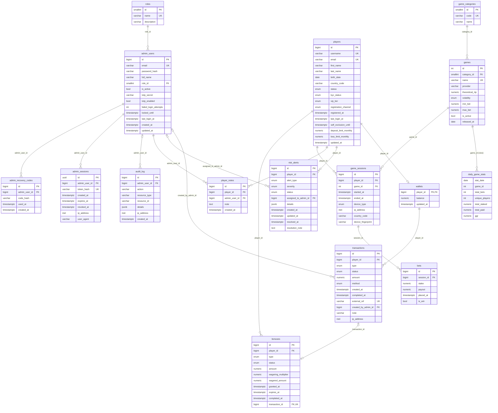

# Database diagram

> Generated from the models by `python api/scripts/generate_erd.py`. Do not edit by hand.

How to read the crow's feet: look at the symbol **next to the other table**.
`||` exactly one, `|o` zero or one, `o{` zero or many, `o|` zero or one (one-to-one side).

## Conventions

- Identifiers: `bigint` identity keys (small lookup tables use `smallint`/`int`).
- Money: `numeric(12,2)`; wallet balance `numeric(14,2)`.
  One currency for the whole casino (not stored per row).
- Timestamps: `timestamptz`, UTC.
- Enumerations: `varchar` + CHECK constraint (easier to migrate than native PostgreSQL enums).
- `players` and `admin_users` are never deleted (deactivate/close instead); financial and gameplay
  foreign keys are `ON DELETE RESTRICT`.
- `daily_game_stats` is a **materialized view** over `bets`; refresh it with
  `REFRESH MATERIALIZED VIEW CONCURRENTLY daily_game_stats;`.
- Wallet is optional at the database level (`players ||--o| wallets`): the application creates one
  wallet per player.

